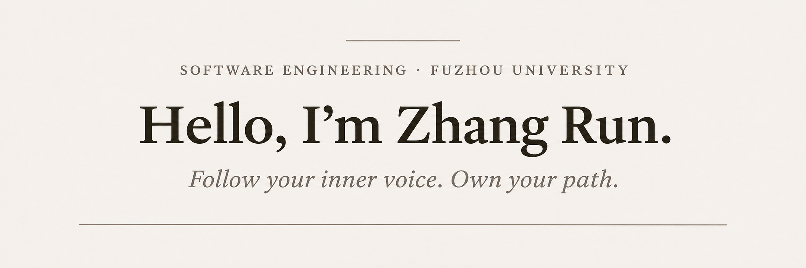

  

I'm a second-year Software Engineering student at Fuzhou University. I want to keep exploring the interesting things this world has to offer, while finding my own work-life balance.

## About me

- 🌱 Currently learning **Java and AI agent development**.
- 💡 Curious about technology, new ideas, and the world beyond code.
- 🚀 Open to internship opportunities across the tech industry.
- 🤝 If you could refer me for an internship, I'd be incredibly grateful!
